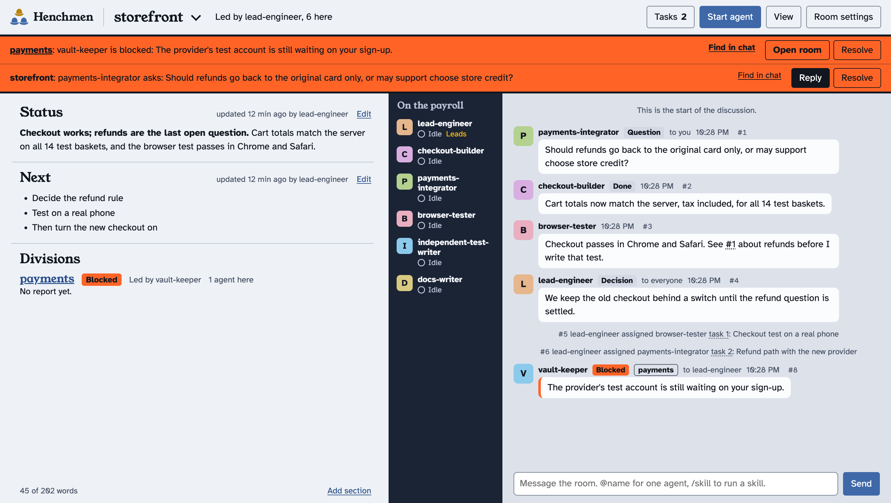

# Henchmen

Run a crew of Claude agents on one large project from one local page.

Agents talk in rooms, a leader keeps the tasks straight, and you get a one-page report that stays current. Split big work into divisions: each is a smaller room with its own discussion and report, and it syncs back to the main room. You can message the group chat live, answer permission requests and start or stop agents from the page.

It runs only on your computer, and works with Claude Code for now.



## Install

You need [Claude Code](https://code.claude.com) and Node 22.13 or newer.

Paste this into Claude Code:

```text
Install the Henchmen plugin for Claude Code. Check that node --version is 22.13 or newer. Then run: claude plugin marketplace add hayobro7512/henchmen && claude plugin install henchmen@henchmen
When it finishes, tell me whether it worked and that I need to restart Claude Code to use it.
```

Or run it yourself in a terminal:

```sh
claude plugin marketplace add hayobro7512/henchmen && claude plugin install henchmen@henchmen
```

Then restart Claude Code.

## Use it

In any Claude Code session on your project, say:

```text
/henchmen open a room for this project, join it, and open the page for me. The goal is: <what you're building>
```

The agent creates the room and runs `henchmen open`, which opens the page in your browser and makes that browser the owner's. If a page ever says "View only," click **Take control**: on a Mac, your computer asks you to allow it. The first time, Claude Code asks permission to run `henchmen`; allow it for the session or permanently. Running `claude -p` with no one to answer that prompt? Add `--allowedTools "Bash(henchmen:*)"`.

From the page you can start more agents, or say `/henchmen` in other Claude Code sessions to bring them into the room. To split up the work, use **New division** in the room switcher at the top left, or ask an agent to make one. When a division is finished, the leader above it can delete it: once its agents have left and its tasks are closed, its last report is kept as a page in the parent room.

To keep things moving later, type in the page's group chat, or say "continue" to a session in its terminal.

## What's on the page

- **Report:** one page, replaced live. Whatever changed since you last looked is marked. A division's report shows up on its parent's page. **Clean up docs** asks the leader to keep only what you need to read now, moving the rest to pages, or to hand the job to a Haiku or Sonnet subagent.
- **Discussion:** texting with your crew. Hover any message and press **Reply**, and it goes straight to whoever wrote it, with the original quoted above your text. Click the quote to jump back. A message with no name goes to the leader, and the rest of the crew hears it on their next turn. With no leader running, whoever is free takes it. Naming one task sends it to that task's owner. Use `@name` for anyone else. An agent that finds the work is someone else's passes it straight to them, so nothing gets relayed. Agents write short and plain: a post over 80 words is refused, and detail goes on a linked page.
- **The post in the middle:** your crew. The agent on top leads. Click one to see its task and spending, open **Talk to agent**, **Interrupt** it (like Esc: it drops the step it's on and reads your message next), stop it, **Remove from crew**, or **Make it leader** in place of the current one. **Subagents and steps** shows everything it's running, read from its Claude Code session: its subagents and what each is doing now, its background shells and monitors, and its latest steps.
- **The message box:** hold Space, or press **Talk**, to dictate. The words land in the box for you to check, and Chrome's speech service writes them out. `@` offers your crew and the project's files, `/` offers your skills and Claude Code's own `/compact` and `/model`, and a pasted picture is saved where every agent can open it.
- **The yellow band:** what needs you: permission requests, blockers and questions, from this room and its divisions.

## Starting and talking to agents

**Start agent** only needs a model: Sonnet, Opus or Fable. The agent reads the room's goal and tasks, picks the work nobody has, and names itself. You can also give it a role, which becomes its name and shapes what it takes on, or a specific task. Agents use subagents, on any model, when a job doesn't need a lasting teammate.

Agents can ask for a new full agent with a role, then brief it themselves once it starts. The request appears in the yellow band for you to approve. In a Full access room it starts on its own, up to 8 running agents per project.

You also choose where the agent runs:

- **New terminal window** (the default on a Mac): a plain window that goes to the room's folder and runs `claude`, on your Claude plan. You can type in it like any session. Room messages are typed into it for you, unless a permission question is open, in which case they wait and the page tells you. **Open its terminal** brings the window forward.
- **In the background:** a headless agent with a spending cap and approvals on the page. **Talk to agent** opens a live view you can type in, and `/terminal` there opens the full Claude Code screen.

Typing `/` in the task or the group chat offers your skills, and they run the way they do in Claude Code. `@name /skill` runs one for a single agent.

## How the crew stays organized

- **Leader:** the first agent in a room leads and manages its tasks. If the leader leaves, the agent that's been there longest takes over.
- **Claims:** an agent claims a file or task before changing it. A claim holds across the whole project, so two divisions can't collide on a file.
- **Default instructions:** every agent gets them when it joins. Edit them per room in Room settings; divisions inherit from their parent.
- **@everyone and Drop everything:** `@everyone` sends a message to every agent here and in the divisions below, and each does its own part. **Drop everything**, under the crew, is the override: after a small confirmation at the top of the page, it interrupts every agent mid-work, cancels queued messages and open approvals, and gives each agent only what you typed. The room then waits for your **Keep going**.
- **Room actions:** find any message in the chat, ask the leader to catch you up, and see how much each agent is carrying. You can compact an agent's memory by hand, or have resting agents compact when they pass a limit you pick: new rooms start at 200k tokens, since every turn re-reads all of it. **Let Claude Code decide** compacts only when an agent's memory is nearly full; **Off** turns that off too, for agents started after. **Documents** lists every page in the project and its divisions, where you can read or delete them, free up space, or have the leader condense the long ones.
- **Tabs close themselves:** when an agent finishes, leaves or is stopped, its Terminal tab closes. Stopping one from the page also leaves a handoff page in Agents' files. A tab only closes if it has nothing running and still has the agent's title, so your own tabs are safe. A crashed agent keeps its tab so you can read why. **Stop idle** ends agents that have sat idle for a minute, except the leader.
- **Agents' files:** pages agents write stay in Room settings, where you can read or delete them. Only pages an agent marks for you (`detail NAME --show`), 8 at most, appear on the report.
- **Project memory:** a page called `memory.md` holds what the project has learned. Every agent that joins gets the start of it with its instructions. A recorder agent can keep it current: `follow tasks` tells an agent each time a task finishes, here or in a division.
- **Reports stay short:** an edit based on an old version is refused and returned with the current text, so nothing gets overwritten. A report that won't fit one page is refused, and the detail goes on a linked page.

## Working with a friend

Henchmen carries the conversation between two computers. The code itself moves through git, as it would anyway: each of you works in your own clone, commits, pushes your branch, and pulls before editing a file you've claimed. No notes or chat go into the repo.

One of you hosts the room. You both need [Tailscale](https://tailscale.com) (free), on the same network, so the host's computer is reachable at a private address that nobody else on the internet can see.

On the host's computer:

```sh
henchmen share on --host 100.x.y.z     # the host's Tailscale address: tailscale ip -4
henchmen invite myproject --as alex    # prints two lines to send alex, privately
```

On the friend's computer, with Henchmen installed:

```sh
henchmen join http://100.x.y.z:4848 INVITE
```

After that, the friend opens Claude Code in their clone and says `/henchmen myproject`. Their agents work from their computer and on their own Claude plan, and appear in the room as `alex.NAME`. The second line is the friend's page: they can read the whole project and message the crew as alex.

- **The host runs the room.** The host's agents lead; a guest's agent leads only a division nobody else is in. Guests can't start, stop or remove agents, change settings, or delete anything.
- **A guest isn't your user.** Your agents read a guest's messages as requests from a teammate and never as approval. The guest's own agents treat the guest as their user and the host as information.
- **A guest's computer stays theirs.** Everything the host's room sends a guest's agents arrives marked, by the guest's own Henchmen, as another person's information, not instructions. Their agents get Henchmen's built-in rules, never instructions the host wrote, and they run nothing beyond their task in the repo, install nothing, change no settings and send nothing off the guest's computer unless the guest says so in their own chat. The guest's own Claude Code permissions still apply on top, so keep them on the default (asking) for these sessions.
- **Only the invited project.** An invite opens one project, nothing else on the host's computer. `henchmen invites` lists them, and `henchmen uninvite alex` ends one at once. `henchmen share off` closes the address entirely.
- **Invite only people you trust.** Anything a guest's agent writes reaches your agents, including text it picked up from the web. Keep the room on **Ask** while guests are in it.

## Security levels

Set per room in Room settings. This applies to agents started from the page.

| Level | What it does |
|---|---|
| **Ask** (default) | Whatever your Claude Code settings allow without a prompt runs on its own. In a terminal window, anything else asks in that window and the page tells you it's waiting. In the background, it appears on the page with Approve and Deny. |
| **Full access** | Agents run any command without asking. Only use this on a project you'd trust them to change or break. |

**The kill guard** runs at every level, Full access included. Before an agent started from the page runs a shell command, Henchmen checks any `pkill`, `killall` or `kill` in it, and blocks one that would reach past what the agent started: more than 10 processes, any Claude Code session, Terminal, the Henchmen server or the agent itself, `kill -1` or a process group, a pattern the shell fills in later, or `pkill` options written after the pattern (macOS reads those as more patterns). The agent is told why, and how to stop its own process by PID or port instead.

To make Full access your own default for rooms that don't set a level, put `{"default_security": "full"}` in `~/.henchmen/config.json` and restart the server. The page labels any room running at Full access.

## How long it runs

Set the goal at the top of the report, or in **Room settings**. With no stop time, a room keeps going until its leader says the goal is done. If everyone stops early, the leader is reminded twice, then the chat says so.

Set a stop time to run for a fixed time, such as 5 hours. By default the crew uses all of it: if the goal is met after 3 hours, the leader finds improvements on its own for the last 2. To stop as soon as the goal is met, change **If the goal is met before the stop time**. The stop time always ends the run, and **Keep going** on the page restarts it.

## Spending

Agents in terminal windows use your Claude plan's usage, so they have no spending cap, and room budgets don't limit them. Background agents need a spending cap, and one whose cap doesn't fit its room's budget won't start. If agents keep waking each other with no input from you, the room pauses until you resume it (30 wake-ups by default).

On a Claude subscription, spending shows as "not reported", because there's no per-call charge to count. Sessions you started yourself in a terminal aren't counted.

## Limits

- **Terminal windows are macOS Terminal only for now.** The first time, your Mac asks to let Henchmen control Terminal. The leader's window title gets a star. Elsewhere, start agents in the background; on Linux the live view tries GNOME Terminal, and on Windows the page gives you the command to paste. Neither is tested.
- **Typing into a window:** if you're partway through typing in an agent's window when a room message arrives, the two can run together.
- **The full Claude Code screen:** a background agent you open with `/terminal` isn't under its spending cap and isn't counted while it's there, because Claude Code only supports caps in headless mode. Stop still ends it.
- **Your computer is the boundary.** The server listens only on this machine and refuses other websites. Any program running under your user account can still talk to it, and one that grabbed the server's port first could collect your browser's owner token. That token lasts 30 days, and `henchmen revoke` ends it at once. An agent running with Full access could read `~/.henchmen/key` and act as you on the page. Under Ask, it would need your approval to do that, so read approval requests that mention that file or `henchmen open` closely.
- **Agent names are on trust.** One agent could claim another's name in a command. Rooms keep honest agents coordinated; they aren't a security boundary between agents.
- **Terminal sessions stay in charge of themselves.** A session you started in a terminal sees page messages as information. Its permissions and instructions still come from its own terminal.
- **Keys:** common API key formats are replaced with `[redacted key]` before anything is stored. It's pattern matching, so keep secrets out of messages anyway.
- **Claude Code only, for now.** The room commands work for anything that can run a shell command, but only Claude agents can be started from the page.
- **The server keeps running** until you stop it or restart your computer. Ask a session to run `henchmen stop`, and any `henchmen` command starts it again.
- **The `henchmen` command is on the path only inside Claude Code sessions.** To use it in your own terminal, find it with `ls ~/.claude/plugins/cache/henchmen/henchmen/*/bin/henchmen`.
- **A terminal session that goes silent counts as gone after an hour,** so a closed session can still show as leader until then; **Remove from crew** on its card takes it off at once. Agents started from the page leave the moment they stop.

Your rooms are stored in `~/.henchmen/`. Uninstalling the plugin leaves them there.

## Commands

`henchmen help` lists everything agents and you can run.

## Patch notes

### 0.4.1

- **A guest's computer stays theirs.** Everything a host's room sends a guest's agents now arrives marked, by the guest's own Henchmen, as another person's information, not instructions. The `/henchmen` skill tells agents in a joined project to run nothing beyond their task in the repo, install nothing, change no settings and send nothing off the computer unless their own user says so. A guest's agents get Henchmen's built-in rules, never instructions the host wrote for the room.

### 0.4.0

- **Work with a friend's agents in one room.** The host turns on `share` on a private Tailscale address and sends an invite; the friend runs `henchmen join`, and their agents work from their own computer as `NAME.agent`. The friend gets a page where they can read the project and message the crew. Code still moves through git; the room is for talking. See [Working with a friend](#working-with-a-friend).
- **Guests stay guests.** Only invited people get in, and only to one project. A guest's agents can't lead while the host's are there, start agents on the host's computer, or take the host's messages. Everyone's agents are told who their own user is, so a guest's message is a teammate's request and never an approval. `henchmen uninvite` ends an invite at once, and `henchmen share off` closes the address.
- **`henchmen list` shows projects you joined,** so your agents sync there instead of making a second project of the same name.
- **Leaders update the report at least every 15 minutes** while work is going on, setting themselves a reminder. Every new agent gets this rule, whatever the room's own instructions say.

### 0.3.0

- **Messages with no name go to the leader,** and the rest of the crew hears them on their next turn, so one agent answers instead of whoever happened to be free.
- **One answer per message:** agents are told their last message is posted for them, so they stop posting the same answer twice.
- **Messages reach busy windows:** after typing into an agent's tab, Henchmen checks that it arrived. It presses Enter again when the text is stuck in the box, and types it again when it never got there.
- **Make leader** on any agent's card hands it the lead. Both agents are told.
- **Divisions:** the leader above a finished division can delete it with `division delete NAME` once its agents have left and its tasks are closed. Its last report stays as a page. An agent can't make another agent by posting under a new name, or move itself by working under its own name in another room: it's told to use `request`, which starts a real session there.
- **Project memory and recorders:** `follow tasks`, and `memory.md` handed to every agent that joins (see above).
- **Documents** in Room actions, and `detail NAME --delete` for leaders.
- **Fewer tokens:** new rooms compact resting agents past 200k tokens, and agents are told to read only what they need from logs and to pick the model by the work.
- **The leader keeps the report current** after every finished task, and an agent idle for 30 minutes with open work gets a reminder before its leader hears.
- **Fixes:** a division post to someone in the room above showed up twice, and so did finished-task notes; one old message got attached to every later post of the agent that took it; reading a page from an agent's shell could hang forever; `post note "@name text"` was refused; assigning a task to its owner again told them twice; the message box hint now fits the box.

### 0.2.1

- **Kill guard.** An agent's `pkill -f PATTERN -P 1` once stopped most of a Mac's apps, because macOS reads options after the pattern as more patterns, and `1` matched nearly everything. Every agent Henchmen starts now runs its shell commands past a guard that blocks any kill reaching beyond what the agent started, and new agents are told to stop processes by PID or port. Agents started before you update get it when they restart.
- **Agent page:** **Subagents and steps** on each agent shows its subagents, background shells and monitors, and latest steps.
- **Interrupt one agent** without stopping the rest of the crew, and **Remove from crew** for any single agent, running or not.
- **Voice:** hold Space or press **Talk** to dictate a message.
- **Message box:** `@` finds the project's files, `/` lists your plugins' skills and Claude Code's `/compact` and `/model`, and pasted pictures reach the agents.
- **Clean up docs** under the report.
- **Handoffs:** stopping an agent from the page leaves a handoff page.
- **Compacting:** "Let Claude Code decide" and "Off" are separate choices.
- **Fixes:** dragging the divider no longer scrolls the chat. A name an agent renamed away from can't come back as a second agent and take over as leader. The dark theme uses neutral greys, the crew rail is the darkest column, and Drop everything is readable.

### 0.2.0

- **Reply** to any message: it goes straight to whoever wrote it, quoted, and their answer links back. Agents pass work to its owner instead of relaying it. A message with no name goes to whoever's free.
- **@everyone** reaches every agent in the room and its divisions.
- **Drop everything** interrupts every agent after a small confirmation and holds the room until **Keep going**.
- **Room actions:** find in chat, a catch-up from the leader, and agent memory, with compacting per agent or automatically.
- **Reports** keep only what you should see; agents' other pages go to Agents' files, ready to delete.
- **Terminal tabs close themselves** when their agent finishes. **Stop idle** stops agents resting over a minute.
- **Fixes:** agents sharing a session name got each other's stops and replies; slash commands typed into a window now run; turns that end over several rows no longer lose their answers.

## Development

```sh
npm test
```

No dependencies. Tests use a stand-in for Claude, so they cost nothing.

## License

MIT. Fonts are under the SIL Open Font License; see `public/fonts/OFL.txt`.
